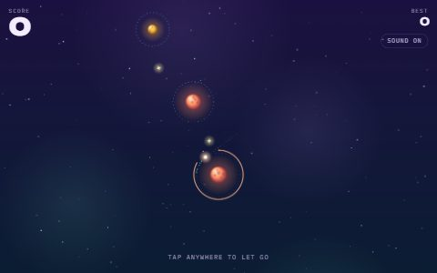
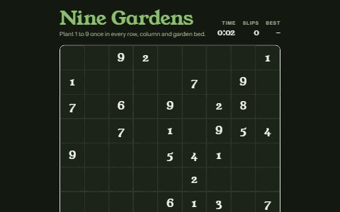
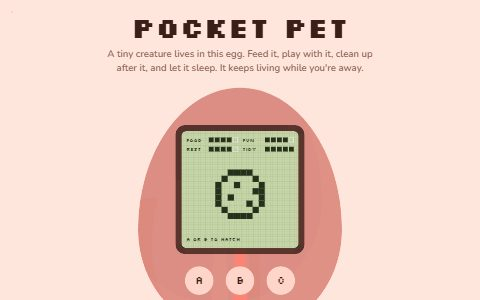

# Pocket Arcade

**100 little games. One shelf. Pick something and play.**

Pocket Arcade is a collection of small browser games, each with its own look, sound, and personality. Take a quick break, chase a high score, or settle into a puzzle. No account or sign-in needed.

## Find your next game

Search by name or description, or browse nine categories:

- **Action** — dodge, jump, fly, and explore.
- **Timing & reflex** — find your rhythm and make every tap count.
- **Sport** — golf, basketball, bowling, darts, and more.
- **Puzzle** — arrange, connect, match, and solve.
- **Words & quiz** — word games and trivia challenges.
- **Brain training** — quick exercises for numbers, colors, and focus.
- **Strategy & board** — familiar boards and small worlds to manage.
- **Cards** — a few hands for a quiet break.
- **Memory** — spot pairs and remember the sequence.

|                    Comet Courier                    |                   Nine Gardens                    |                  Pocket Pet                   |
| :-------------------------------------------------: | :-----------------------------------------------: | :-------------------------------------------: |
|  |  |  |
|             Slingshot between planets.              |           Solve a garden-themed Sudoku.           |      Care for a tiny virtual companion.       |

## How to play

Choose a game from the shelf. It opens in a new tab with its own instructions. Controls vary by game: use your mouse, keyboard, or touch screen as indicated.

Games that track scores and progress save them in your browser. Keep using the same browser and site address to continue; clearing site data resets those saves. Sound starts after you interact with a game.

## Run locally

With Node.js 24 installed:

```sh
npm ci
npm run dev
```

Open the local address shown in your terminal.

Built with React, TypeScript, Tailwind CSS, and Vite. See [CONTRIBUTING.md](CONTRIBUTING.md) for development and deployment notes.
